# 🎵 Awesome Generative Music & Loop Composition AI 🔁

<p align="center">
  
</p>

<p align="center">
  <a href="https://github.com/ishandutta2007/Awesome-Awesome-Awesome"></a>
  <a href="https://discord.gg/jc4xtF58Ve"></a>
  <a href="https://github.com/ishandutta2007/Awesome-Generative-Music-Loop-Composition-AI"></a>
  <a href="https://github.com/ishandutta2007/Awesome-Generative-Music-Loop-Composition-AI/stargazers"></a>
  <a href="https://github.com/ishandutta2007/Awesome-Generative-Music-Loop-Composition-AI/network/members"></a>
  <a href="https://github.com/ishandutta2007/Awesome-Generative-Music-Loop-Composition-AI/graphs/contributors"></a>
  <a href="https://github.com/ishandutta2007/Awesome-Generative-Music-Loop-Composition-AI/blob/main/LICENSE"></a>
  <a href="https://github.com/ishandutta2007"></a>
</p>

---

# 🎧 Top Generative Music & Loop Composition AI Tools & Frameworks

> **Curated directory of SaaS & commercial platforms and open-source GitHub repositories for seamless music loop synthesis, AI beatmaking, symbolic MIDI composition, live-coding pattern sequencers, and stem remixing.**

Whether you are an electronic music producer looking for infinite seamless audio loops, an indie game developer needing adaptive generative soundscapes, or an AI audio researcher training neural waveform models, this directory provides a comprehensive, verified guide.

---

## 📑 Table of Contents

- [📊 Sector Overview & Market Dynamics](#-sector-overview--market-dynamics)
- [☁️ SaaS / Hosted & Commercial Platforms](#️-saas--hosted--commercial-platforms)
- [💻 Open-Source GitHub Projects](#-open-source-github-projects)
- [🎯 Choosing the Right Tool: Decision Matrix](#-choosing-the-right-tool-decision-matrix)
- [🛠️ How to Contribute](#️-how-to-contribute)
- [📈 Star History](#-star-history)
- [⚠️ Disclaimer](#️-disclaimer)
- [💖 Support & Community](#-support--community)

---

## 📊 Sector Overview & Market Dynamics

The global Generative AI Music, Loop Composition, and Adaptive Audio Software sector is projected to reach **$3.8B–$5.4B+ in 2026**, growing at a **~30%–38% CAGR** driven by DAW integrations, virtual production, streaming creator licensing, and interactive game audio engines.

Market dynamics show **moderate-to-high consolidation** in the end-user consumer song-generation segment around prominent frontrunners (notably **Suno AI** and **Udio**), while the **B2B royalty-free loop generation and developer tooling tier remains moderately fragmented** with specialized category leaders (Soundful, Soundraw, Mubert, Beatoven.ai). Concurrently, foundation audio model research, rhythmic loop synthesis, live-coding sequencer engines, and MIDI generation are intensely driven by an open-source ecosystem led by Meta AudioCraft, Google Magenta, Tencent LoopForge, MAP YuE, and TidalCycles/Strudel.

---

## ☁️ SaaS / Hosted & Commercial Platforms

*Commercial AI music studios, text-to-beat engines, and loop synthesis suites. Sorted descending by estimated company valuation / capital scale.*

| 🏢 Platform | 📝 Description & Strengths | 💰 Company Scale (Valuation / Revenue) | 🏷️ Starting Paid Tier | 🎁 Free Tier / Trial Limit |
| :--- | :--- | :--- | :--- | :--- |
| **[Suno AI](https://suno.com)** | 🌟 Frontier text-to-song and vocal synthesis engine generating complete multi-genre songs, stems, instrumental backing loops, and audio continuations. | **~$500M+ Valuation** ($125M+ Series B funding led by Lightspeed & Nat Friedman) | **$8.00 / month** billed annually ($10/mo billed monthly for Pro plan; 2,500 credits / ~500 songs per month) | **Forever Free Basic Plan** (**50 free credits refreshed daily**, yielding ~10 generated songs/loops per day for non-commercial personal use with Suno attribution) |
| **[Udio](https://udio.com)** | 🎛️ High-fidelity generative music studio featuring precise audio inpainting, audio-to-audio remixing, stem separation, and lyric-level timing controls. | **~$150M–$300M Est. Valuation** ($10M+ seed funding backed by a16z, will.i.am, and music veterans) | **$8.00 / month** billed annually ($10/mo billed monthly for Standard plan; 1,200 monthly credits with priority queues) | **Forever Free Plan** (**10 free daily credits + 100 bonus monthly credits** for non-commercial tracks and standard audio rendering) |
| **[Splash Pro (Popgun)](https://splashmusic.com)** | 🎤 AI music and beat production engine featuring natural AI singing, text-to-rap vocals, and beat-synced loop generation for producers and game audio designers. | **~$30M–$50M Est. Valuation** ($20M+ venture backing led by Khosla Ventures & BITKRAFT) | **$10.00 / month** billed annually ($15/mo billed monthly for Starter plan; $35/mo Max plan with full commercial license) | **Forever Free Starter Tier** (Unlimited interactive preview playback and basic text-to-beat/vocal synthesis directly in web browser) |
| **[Soundraw](https://soundraw.io)** | 🎹 Interactive AI music composer allowing bar-by-bar arrangement, tempo modification, drum loop customization, and energy contour adjustment. | **~$20M–$40M Est. Valuation** (~$12M+ venture funding; Tokyo & US audio tech studio) | **$11.04 / month** billed annually ($16.99/mo billed monthly for Creator plan with unlimited track downloads) | **Forever Free Preview Plan** (**Unlimited AI song/loop generation and composition editing** in-browser; paid subscription required to export WAV/MP3 files) |
| **[Mubert](https://mubert.com)** | ⚡ Real-time generative music engine, DAW plugin, and REST API generating endless royalty-free loops, rhythmic stems, and adaptive game soundtracks. | **~$15M–$30M Est. Valuation** (~$5M+ est. ARR; powers >100,000 streaming creators and apps) | **$11.69 / month** billed annually ($14/mo billed monthly for Creator plan; up to 500 track downloads per month) | **Forever Free Ambassador Plan** (Up to **25 free generated tracks per month** for personal social media use with mandatory Mubert audio watermark/attribution) |
| **[Boomy](https://boomy.com)** | 🚀 Rapid AI song and loop synthesizer enabling users to create custom drum and instrument beats, arrange arrangements, and publish directly to DSP streaming platforms. | **~$15M–$25M Est. Valuation** (US generative audio platform; >20M community songs synthesized) | **$9.99 / month** for Creator plan (500 track saves/mo + 10 commercial releases/mo to streaming services) | **Forever Free Plan** (Unlimited track creation and up to **25 free track saves** for personal non-commercial listening) |
| **[Beatoven.ai](https://beatoven.ai)** | 🎬 Mood-based, royalty-free AI background music and loop composer built for video creators, podcasters, and indie game designers with multi-track stem manipulation. | **~$10M–$20M Est. Valuation** (Venture-backed global AI sound studio) | **$6.00 / month** for 15 minutes of commercial download quota per month (or **$3.00/minute** on-demand pay-as-you-go) | **Forever Free Trial Workspace** (**Unlimited track synthesis and multi-track stem editing** in browser + 1 complimentary free track download upon signup) |
| **[AIVA](https://aiva.ai)** | 🎼 Classical, cinematic, and electronic symphonic AI composer generating emotional thematic compositions with full multi-track MIDI and audio stem export. | **~$10M–$20M Est. Valuation** (Backed by NetEase; European pioneer in AI musical copyright) | **€11.00 / month** billed annually (€15/mo monthly for Standard plan; €33/mo Pro plan with full commercial copyright ownership) | **Forever Free Plan** (**3 free track downloads per month** up to 3 minutes duration each for non-commercial projects with mandatory AIVA attribution) |
| **[Soundful](https://soundful.com)** | 🥁 Producer-oriented AI music generation platform producing beat loops, instrument loops, and customizable full stems across 50+ modern genre templates. | **~$10M–$20M Est. Valuation** (Venture-backed San Diego audio intelligence company) | **$5.00 / month** billed annually ($9.99/mo billed monthly for Content Creator plan; 100 track downloads/mo) | **Forever Free Plan** (Unlimited web track previews + **10 free MP3 downloads per month** for personal creative projects with creator attribution) |
| **[Loudly](https://loudly.com)** | 🔊 Generative AI music engine and loop studio combining text-to-music generation, stem isolation, instant tempo adjustments, and customized remixing. | **~$10M–$15M Est. Valuation** (Berlin-based music AI creation suite) | **$5.99 / month** billed annually ($11.99/mo billed monthly for Personal plan; 300 track downloads/mo) | **Forever Free Plan** (Up to **25 free AI track generations per month** and 1 free MP3 audio download per month for personal use) |

---

## 💻 Open-Source GitHub Projects

*Open-source generative music models, loop synthesizers, live-coding algorithmic music environments, stem separators, and symbolic MIDI frameworks. Ranked in descending order of GitHub stars.*

| 📦 Repository | ⭐ GitHub Stars | ⚖️ License | 🎯 Category / Focus | 📖 Summary & Capabilities |
| :--- | :--- | :--- | :--- | :--- |
| **[Meta AudioCraft](https://github.com/facebookresearch/audiocraft)** | [](https://github.com/facebookresearch/audiocraft/stargazers) | **MIT** | Audio & Music Foundation Models | PyTorch library featuring **MusicGen** (text-to-music & melody conditioning), **AudioGen**, and **EnCodec** neural audio compression. Industry standard for local generative music inference. |
| **[Google Magenta](https://github.com/magenta/magenta)** | [](https://github.com/magenta/magenta/stargazers) | **Apache-2.0** | Symbolic AI & Neural Audio | Google Brain's pioneering research suite for generative music and art. Features **MusicVAE**, **MelodyRNN**, **DDSP** (Differentiable Digital Signal Processing), and MIDI generation plugins. |
| **[MAP YuE](https://github.com/multimodal-art-projection/YuE)** | [](https://github.com/multimodal-art-projection/YuE/stargazers) | **Apache-2.0** | Full-Song & Vocal Synthesis | Frontier open foundation model producing complete full-length vocal and instrumental music tracks directly from lyrics and musical style prompts using multi-stage tokenization. |
| **[Sonic Pi](https://github.com/sonic-pi-net/sonic-pi)** | [](https://github.com/sonic-pi-net/sonic-pi/stargazers) | **GPL-2.0** | Live-Coding & Algorithmic Loops | The live-coding music synth designed by Sam Aaron. Enables live algorithmic pattern loops, synths, and beat sequencing for live performance and classroom music education. |
| **[LMMS](https://github.com/LMMS/lmms)** | [](https://github.com/LMMS/lmms/stargazers) | **GPL-2.0** | Open Digital Audio Workstation | Cross-platform open-source digital audio workstation (DAW) for composing melodies, sequencing drum loops, synthesizing sound effects, and integrating generative audio VST plugins. |
| **[Meta Demucs](https://github.com/facebookresearch/demucs)** | [](https://github.com/facebookresearch/demucs/stargazers) | **MIT** | Deep Music Stem Separation | SOTA deep neural network for isolating drums, bass, vocals, and other stems from mixed audio tracks. Essential utility for beat remixers, loop sample preparation, and training datasets. |
| **[Spotify Basic Pitch](https://github.com/spotify/basic-pitch)** | [](https://github.com/spotify/basic-pitch/stargazers) | **Apache-2.0** | Audio-to-MIDI Transcription | Lightweight, polyphonic audio-to-MIDI neural network converter by Spotify. Translates raw recorded loops, vocals, and instruments into editable symbolic MIDI notes and pitch bends. |
| **[Tencent LoopForge](https://github.com/Tencent/LoopForge)** | [](https://github.com/Tencent/LoopForge/stargazers) | **Apache-2.0** | Seamless Loop Synthesis | Tencent's generative music loop composition framework explicitly optimized for generating seamless, rhythmically locked musical loops and beat stems with tempo/key conditioning. |
| **[ACE-Step](https://github.com/ace-step/ACE-Step)** | [](https://github.com/ace-step/ACE-Step/stargazers) | **Apache-2.0** | Music Generation Foundation Model | Advanced open-source music synthesis framework designed for efficient audio diffusion generation, high-fidelity sample output, and multi-track musical stem synthesis. |
| **[Hundred Rabbits Orca](https://github.com/hundredrabbits/Orca)** | [](https://github.com/hundredrabbits/Orca/stargazers) | **MIT** | Algorithmic MIDI Sequencer | Two-dimensional esoteric live-coding environment where every letter of the alphabet functions as an operation for creating generative procedural MIDI, UDP, and OSC loops. |
| **[Microsoft Muzic](https://github.com/microsoft/muzic)** | [](https://github.com/microsoft/muzic/stargazers) | **MIT** | Music Understanding & Generation | Microsoft Research project encompassing neural song composition, lyric-to-melody generation, symbolic accompaniment synthesis, and expressive MIDI performance modeling. |
| **[Stable Audio Tools](https://github.com/Stability-AI/stable-audio-tools)** | [](https://github.com/Stability-AI/stable-audio-tools/stargazers) | **MIT** | Audio Diffusion Architecture | Official training and inference framework behind Stability AI's **Stable Audio Open**, generating variable-length audio tracks, rhythm loops, and sound effects via latent diffusion. |
| **[Riffusion](https://github.com/riffusion/riffusion-hobby)** | [](https://github.com/riffusion/riffusion-hobby/stargazers) | **MIT** | Spectrogram Audio Diffusion | Real-time music and beat generation using fine-tuned Stable Diffusion on audio spectrograms with seamless loop interpolation and audio prompting. |
| **[lucidrains MusicLM-PyTorch](https://github.com/lucidrains/musiclm-pytorch)** | [](https://github.com/lucidrains/musiclm-pytorch/stargazers) | **MIT** | Neural Music Implementation | Clean, community-driven PyTorch replication of Google's MusicLM architecture combining AudioLM, MuLan, and SoundStream for conditional text-to-music generation. |
| **[Strudel](https://github.com/tidalcycles/strudel)** | [](https://github.com/tidalcycles/strudel/stargazers) | **GPL-3.0** | Web Live-Coding Pattern Sequencer | JavaScript and WebAudio port of the legendary TidalCycles music sequencer. Enables algorithmic beat looping, Euclidean rhythms, and WebAudio synth control directly in browser. |
| **[TidalCycles](https://github.com/tidalcycles/Tidal)** | [](https://github.com/tidalcycles/Tidal/stargazers) | **GPL-3.0** | Algorithmic Pattern Language | Haskell-based domain-specific language for live-coding musical rhythms, polymetric beat loops, and continuous polyphonic structural patterns. |
| **[AudioLDM 2](https://github.com/haoheliu/AudioLDM2)** | [](https://github.com/haoheliu/AudioLDM2/stargazers) | **Compute Only / CC-BY-NC-SA-4.0** | Latent Diffusion Audio | Latent diffusion framework utilizing Language of Audio (LOA) representations to synthesize high-quality music, instrumental textures, and environmental soundscapes. |
| **[ASLP DiffRhythm](https://github.com/ASLP-lab/DiffRhythm)** | [](https://github.com/ASLP-lab/DiffRhythm/stargazers) | **Apache-2.0** | Diffusion Singing & Song Generator | Latent diffusion model tailored for full-song synthesis and expressive singing voices with precise lyric-to-audio rhythm alignment and prompt conditioning. |
| **[MuseGAN](https://github.com/salu133445/musegan)** | [](https://github.com/salu133445/musegan/stargazers) | **MIT** | Multi-Track Symbolic GAN | Deep generative adversarial network tailored for synthesizing multi-track polyphonic pop music loops with interdependent bass, drums, guitar, and piano accompaniment. |
| **[NotaGen](https://github.com/ElectricAlexis/NotaGen)** | [](https://github.com/ElectricAlexis/NotaGen/stargazers) | **Apache-2.0** | Classical Music Score Generation | Autoregressive language modeling and generative transformer framework creating multi-instrument symbolic classical compositions and structured sheet music scores. |
| **[FoxDot](https://github.com/Qirky/FoxDot)** | [](https://github.com/Qirky/FoxDot/stargazers) | **GPL-3.0** | Python Live-Coding Music | Python library designed to interact with the SuperCollider audio synthesis engine, enabling rapid creation of live electronic loops, polyrhythms, and synth leads. |

---

## 🎯 Choosing the Right Tool: Decision Matrix

```
                       What is your generative audio goal?
                                       │
        ┌──────────────────────────────┼──────────────────────────────┐
        ▼                              ▼                              ▼
 Complete Songs & Vocals       Seamless Audio Loops          Symbolic MIDI & Coding
  • Suno AI (Commercial)        • LoopForge (Open-Source)     • Strudel / TidalCycles (Live)
  • Udio (Commercial)           • Meta MusicGen (Local GPU)   • Google Magenta (Symbolic)
  • MAP YuE (Open-Source)       • Soundful / Mubert (SaaS)    • Spotify Basic Pitch (Audio2MIDI)
```

- 🎧 **Need instant radio-ready songs with vocals for video content?** Choose **[Suno AI](https://suno.com)** or **[Udio](https://udio.com)**.
- 🔁 **Need seamless, beat-synced background loops without seam clicks?** Deploy **[Tencent LoopForge](https://github.com/Tencent/LoopForge)** locally or use **[Soundful](https://soundful.com)**.
- 💻 **Want total local control with PyTorch weights?** Run **[Meta AudioCraft / MusicGen](https://github.com/facebookresearch/audiocraft)** or **[Stability AI Stable Audio Tools](https://github.com/Stability-AI/stable-audio-tools)**.
- 🎛️ **Remixing or training your own model?** Isolate stems with **[Meta Demucs](https://github.com/facebookresearch/demucs)** and convert audio to MIDI with **[Spotify Basic Pitch](https://github.com/spotify/basic-pitch)**.
- 🎹 **Live algorithmic performances and live-coding jams?** Spin up **[Strudel](https://github.com/tidalcycles/strudel)** in your web browser or connect **[Sonic Pi](https://github.com/sonic-pi-net/sonic-pi)** to your synthesizers.

---

## 🛠️ How to Contribute

We welcome additions, updates, and benchmark insights from the music AI community! 

1. 🍴 Fork this repository.
2. 🌿 Create a new feature branch (`git checkout -b add-my-music-tool`).
3. ✏️ Add the project to the matching table (**Commercial SaaS** or **Open-Source GitHub Projects**).
   - *Ensure commercial SaaS entries include exact pricing and free tier/trial limits.*
   - *Ensure open-source entries include a valid GitHub star badge with `style=social&color=white` linking to the repository's stargazers page.*
   - *Maintain strict descending order (Valuation/Revenue for SaaS, GitHub Stars for Open-Source).*
4. 💾 Commit your changes (`git commit -m "feat: add NewMusicTool"`).
5. 🚀 Push to the branch and open a Pull Request.

---

## 📈 Star History

[](https://www.star-history.com/#ishandutta2007/Awesome-Generative-Music-Loop-Composition-AI&type=date&legend=top-left)

---

## ⚠️ Disclaimer

*Company valuations, product pricing tiers, and GitHub star counts reflect publicly available data as of late 2026 and may evolve over time. All product names, logos, and brands are property of their respective owners. Inclusion in this list does not constitute an official endorsement.*

---

## 💖 Support & Community

A huge **Thank You** to all researchers, developers, sound designers, and musicians contributing to and advancing generative music technology!

If you find this curated collection helpful:
- ⭐ **Star** this repository to help others discover it
- 🍴 **Fork** and contribute your own tools, models, and workflows
- 📢 **Share** it with fellow beatmakers, audio engineers, and AI enthusiasts
- ☕ **Support the maintainer**: If you'd like to support continued maintenance and curation of open-source resources, consider [sponsoring or buying a coffee via the GitHub Sponsors Dashboard](https://github.com/sponsors/ishandutta2007)!

<p align="center">
  <a href="https://github.com/sponsors/ishandutta2007"></a>
</p>

<p align="center">
  <b>Curated with ❤️ by <a href="https://github.com/ishandutta2007">Ishan Dutta</a></b>
</p>
